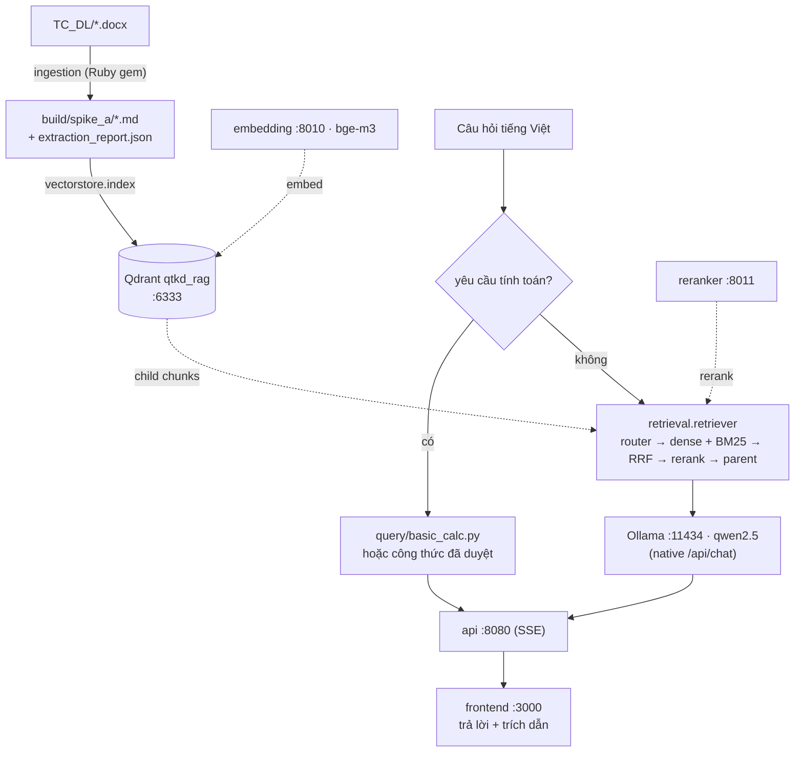

# RAG-TC-DL - Tra cứu QTKĐ và tính công thức đã phê duyệt

Ứng dụng React + FastAPI tra cứu quy trình kiểm định (QTKĐ) bằng RAG.
Câu trả lời bằng tiếng Việt, kèm nguồn trích dẫn và công thức hiển thị đúng như tài liệu gốc.
Luồng tính riêng nằm ở màn hình **Tài liệu → chọn DOCX → Công thức và phê duyệt**.

Toàn bộ model chạy local, không gọi API đám mây.
Lần cài đặt đầu cần mạng để tải thư viện và model, sau đó vận hành offline.

LLM không tự tạo phép tính được phép chạy.
Ingestion chỉ gợi ý biểu thức và metadata.
Công thức chưa duyệt, sai phiên bản hoặc nguồn hết hiệu lực đều bị chặn.
Chat hướng dẫn mở form tính, chưa tự chọn ID công thức đã duyệt từ hội thoại.

## Trạng thái và giới hạn

- Backend và frontend có tạo, xem, sửa, duyệt, từ chối nháp công thức, ca đối chứng, kiểm tra đơn vị/miền/điều kiện và form tính.
- Chỉnh định nghĩa thu hồi phê duyệt.
- Xóa rồi tải lại nguồn cũ phải duyệt lại.
- PDF có trích text để tra cứu nhưng chưa tạo được nháp công thức có định vị.
- OLE/MathType lỗi và biểu thức phức tạp cần đối chiếu thủ công.
- Đăng nhập là bắt buộc (`AUTH_ENABLED=true`), người duyệt được ghi theo tài khoản đăng nhập.
- Nhật ký duyệt không thay thế phê duyệt chuyên môn.
- Điểm 96% trước đây là điểm checklist sau khi sửa các ca đã biết, không chứng minh độ chính xác nghiệp vụ.
  Xem [audit đánh giá](build/formula-review/BIAS_AUDIT.md) và [báo cáo cũ](build/formula-review/INDEPENDENT_REVIEW.md).

## Thành phần

| Thành phần | Cổng | Chức năng |
|---|---|---|
| **Frontend** `frontend/` (React + Vite + Tailwind, nginx) | `:3000` (dev Vite `:5173`) | Chat SSE, Markdown + bảng + công thức KaTeX, trích dẫn `[n]`, panel nguồn, lịch sử hội thoại, quản lý tài liệu và công thức |
| **API** `api/` (FastAPI) | `:8080` | `/api/chat/stream` (SSE), tài liệu, xác thực, sổ công thức |
| **LLM** Ollama + Qwen2.5 | `:11434` | Model `models.llm_chat` trong `config/settings.yaml` (mặc định `qwen2.5:7b-instruct`). `llm/generator.py` gọi native `/api/chat` |
| **Embedding** `bge-m3` (1024 chiều) | `:8010` | `docker/inference/server.py`, `/v1/embeddings` |
| **Reranker** `bge-reranker-v2-m3` | `:8011` | Cùng server, `/v1/rerank` |
| **Vector store** Qdrant | `:6333` | Collection `qtkd_rag`, cosine, 1024 chiều |
| **PostgreSQL** | `:5432` | Tài khoản, bảng `procedure`, tài liệu |
| **Trích xuất công thức** | - | Python `lxml` + `olefile`, Ruby gem `mathtype_to_mathml`, XSLT `vendor/xsltml/mml2tex.xsl`: OLE MathType → LaTeX |
| **Hybrid retrieval** `retrieval/` | - | router → lexicon → dense + BM25 → RRF (k=60) → rerank trên parent → parent |

`frontend-legacy/` là bản React đời trước, giữ để tham khảo.

---

## 1. Cài đặt bằng Docker

Cách này dựng toàn bộ stack (postgres, qdrant, embedding, reranker, ollama, api, frontend) bằng Docker Compose.
Image `api` đã có sẵn Ruby, gem `mathtype_to_mathml` và LibreOffice nên không cần cài gì thêm trên máy để bóc công thức.

### 1.1 Yêu cầu

| Thành phần | Ghi chú |
|---|---|
| Docker + Docker Compose v2 | Windows: Docker Desktop (WSL2). Linux: Docker Engine |
| GPU NVIDIA + driver + NVIDIA Container Toolkit | `docker-compose.yml` khai báo GPU cho embedding, reranker, Ollama. Target: RTX 5060 8GB, CUDA 12.8+ |
| RAM | Tối thiểu 16GB. Windows nên đặt `memory=12GB` trong `%UserProfile%\.wslconfig` |
| Ổ đĩa trống | Khoảng 40GB (image khoảng 30GB, model Qwen 4,7GB, cache HuggingFace) |
| `make` | Tùy chọn. Trên Windows chạy thẳng lệnh `docker compose` ở bên dưới |

Máy không có GPU NVIDIA: xem mục 1.6.

### 1.2 Cấu hình `.env`

```bash
cp .env.example .env
mkdir -p .formula-registry build/spike_a
```

Mở `.env` và đặt tối thiểu:

| Biến | Ý nghĩa |
|---|---|
| `QDRANT_API_KEY` | **Bắt buộc**, thiếu thì compose không chạy. Sinh bằng `python3 -c "import secrets; print(secrets.token_urlsafe(48))"` |
| `JWT_SECRET_KEY` | Để trống khi dev (khóa tạm, token mất khi restart). Production (`APP_ENV=production`) bắt buộc, từ 32 byte |
| `POSTGRES_PASSWORD` | Production phải đổi khỏi mặc định `qtkd_password` |
| `APP_UID`, `APP_GID` | Linux: đặt theo `id -u` và `id -g` nếu khác 1000, để file ghi vào `TC_DL/` thuộc đúng người dùng |
| `OLLAMA_MODEL` | Để trống thì dùng `models.llm_chat` của `config/settings.yaml` |

Mọi tham số khác nằm ở `config/settings.yaml`.
Biến trong `.env` ghi đè file đó theo mẫu `${TÊN:-mặc_định}`.

### 1.3 Build và chạy

```bash
docker compose up -d --build
```

Tương đương `make up`.
Lần đầu mất 10 đến 20 phút (lâu hơn khi mạng chậm) vì phải tải torch/CUDA và model bge.

Build 4 image song song dễ làm Docker Desktop hết RAM rồi chết giữa chừng (lỗi `EOF`).
Trong trường hợp đó build tuần tự:

```powershell
$env:COMPOSE_PARALLEL_LIMIT=1
docker compose up -d --build
```

```bash
COMPOSE_PARALLEL_LIMIT=1 docker compose up -d --build
```

Thứ tự khởi động do compose tự xử lý: postgres, qdrant, ollama (nạp model chat lên GPU), reranker, embedding, api, frontend.
Embedding và reranker chỉ lấy GPU nếu còn đủ VRAM (`GPU_MIN_FREE_MB`), nếu không sẽ chạy CPU.

### 1.4 Thiết lập lần đầu

```bash
# 1. Tải LLM vào container ollama (~4,7GB)
docker compose exec ollama ollama pull qwen2.5:7b-instruct      # = make pull-model

# 2. Tạo tài khoản quản trị đầu tiên
docker compose exec api python scripts/create_admin.py

# 3. Mở http://localhost:3000 và đăng nhập
```

Nạp tài liệu có ba cách:

- **Qua giao diện:** vào tab Tài liệu, tải lên `.docx`, `.doc` hoặc `.pdf` rồi bấm "Xử lý".
  API tự bóc công thức, chunk, embed và đưa vào Qdrant.
- **Hàng loạt bằng CLI (`.docx`, `.doc`, `.pdf`):** xem "Nạp bằng CLI" ngay dưới.

#### Nạp bằng CLI (`.docx`, `.doc`, `.pdf`)

`scripts/ingest_cli.py` đi đúng đường của giao diện: đăng nhập, upload, xử lý, rồi đợi tới khi xong.
Nhận `.docx`, `.doc`, `.pdf`; truyền thư mục thì duyệt đệ quy.
Chỉ dùng thư viện chuẩn của Python nên chạy được trên máy không có venv.
Tài khoản cần vai trò technician hoặc admin.

```bash
# API chạy trên máy này (http://localhost:8080); mật khẩu được hỏi khi chạy, không hiện trên màn hình
python scripts/ingest_cli.py TC_DL/ --user admin

# Một vài tệp cụ thể
python scripts/ingest_cli.py a.docx b.doc c.pdf --user admin

# API ở máy khác: tự mở tunnel SSH (mật khẩu SSH đọc từ tệp)
python scripts/ingest_cli.py ~/qtkd/ --ssh user@host --ssh-pass-file ~/.host_pw --user admin

# Chạy không tương tác (script, cron): đưa mật khẩu qua tệp hoặc biến môi trường
python scripts/ingest_cli.py TC_DL/ --user admin --password-file ~/.qtkd_pw
QTKD_PASSWORD=... python scripts/ingest_cli.py TC_DL/ --user admin
```

| Tham số | Ý nghĩa |
|---|---|
| `paths` | Tệp hoặc thư mục (`.docx`, `.doc`, `.pdf`) |
| `--api URL` | URL API khi không dùng SSH (mặc định `http://localhost:8080`) |
| `--user` | Tài khoản ứng dụng (hoặc `QTKD_USER`) |
| `--password-file` | Tệp chứa mật khẩu tài khoản (bỏ qua thì được hỏi; hoặc `QTKD_PASSWORD`) |
| `--ssh USER@HOST` | Mở tunnel SSH tới API trên host |
| `--ssh-pass-file` | Tệp mật khẩu SSH (bắt buộc với `--ssh`) |
| `--remote-port` | Cổng API trên host (mặc định 8080) |

Trạng thái kết thúc của mỗi tệp là `ready`, `superseded` (có bản mới hơn cùng số QTKĐ) hoặc `error`.

#### Index hàng loạt từ `TC_DL/` (chỉ `.docx`)

Đặt file vào `TC_DL/`, xử lý tài liệu, rồi index lại:

```bash
docker compose --profile tools run --rm indexer                  # = make index (bỏ qua file đã index)
docker compose --profile tools run --rm indexer python -m vectorstore.index --force   # = make reindex
```

Indexer đọc Markdown trong `build/spike_a/`.
Thư mục này do bước xử lý tài liệu tạo ra, nên phải xử lý tài liệu (qua giao diện hoặc ingestion) trước khi index hàng loạt.

Lệnh `indexer` chỉ nạp Markdown đã có trong `build/spike_a/`, và bước tạo Markdown hàng loạt (`ingestion.spike_a`) chỉ xử lý `.docx`.
Muốn nạp `.doc` và `.pdf`, dùng giao diện hoặc CLI ở trên.

Mỗi số QTKĐ chỉ giữ một phiên bản trong chỉ mục: bản có năm ban hành mới hơn thắng, bản cũ chuyển sang `superseded`.

### 1.5 Vận hành hằng ngày

| Lệnh | Tác dụng |
|---|---|
| `docker compose up -d` (`make start`) | Chạy, không build lại |
| `docker compose down` (`make down`) | Dừng toàn bộ, giữ dữ liệu |
| `docker compose logs -f api` (`make logs`) | Xem log |
| `docker compose ps` (`make status`) | Trạng thái container |
| `docker compose build --no-cache && docker compose up -d` (`make rebuild`) | Build lại sạch khi sửa code hoặc Dockerfile |
| `docker compose down -v` (`make clean-volumes`) | **Xóa dữ liệu**: Postgres, model Ollama, cache HuggingFace |

Cổng dịch vụ:

| URL | Dịch vụ |
|---|---|
| `http://localhost:3000` | Giao diện web |
| `http://localhost:8080/api/health` | API |
| `http://localhost:8010`, `:8011` | Embedding, reranker |
| `http://127.0.0.1:6333` | Qdrant (chỉ mở local, cần API key) |
| `http://localhost:11434` | Ollama |

Dữ liệu bền, cần sao lưu:

| Dữ liệu | Nơi lưu |
|---|---|
| Vector | `./qdrant_storage/` (bind mount) |
| Tài liệu gốc | `./TC_DL/` |
| Markdown đã bóc | `./build/spike_a/` |
| Sổ công thức (SQLite) | `./.formula-registry/` (sao lưu cùng `TC_DL/`) |
| Postgres | volume `postgres_storage` |
| Model LLM | volume `ollama_data` |
| Model embedding, reranker | volume `hf_cache_embedding`, `hf_cache_reranker` |

### 1.6 Máy không có GPU NVIDIA

Compose hiện yêu cầu NVIDIA cho embedding, reranker và Ollama.
Với macOS hoặc máy không có GPU NVIDIA:

1. Cài Ollama chạy native (`brew install ollama`, `ollama serve`).
2. Đặt trong `.env`: `OLLAMA_URL=http://host.docker.internal:11434/v1/chat/completions`.
   `llm/generator.py` tự map sang `/api/chat`, vì endpoint `/v1` của Ollama bỏ qua trường `options` (num_ctx và num_predict mất hiệu lực).
3. Xóa khối `deploy.resources` và service `ollama` trong `docker-compose.yml` cho các service không dùng GPU.

Chỉ thử giao diện và luồng duyệt/tính công thức (RAG chưa hoạt động):

```bash
docker compose up -d --no-deps postgres api frontend
```

### 1.7 Dọn dẹp và lỗi thường gặp

| Triệu chứng | Cách xử lý |
|---|---|
| Build chết với `EOF` hoặc treo hàng giờ | Build tuần tự (`COMPOSE_PARALLEL_LIMIT=1`), tăng RAM WSL, kiểm tra ổ đĩa bằng `docker system df` |
| Compose báo thiếu `QDRANT_API_KEY` | Đặt khóa trong `.env` (mục 1.2) |
| Xóa dữ liệu Docker mà ổ C không giảm (Windows) | File `.vhdx` của Docker không tự co. Dùng Settings, Resources, Disk image size trong Docker Desktop, hoặc `wsl --shutdown` rồi `Optimize-VHD` |
| `api` không healthy | `docker compose logs api`. Production thiếu `JWT_SECRET_KEY` hoặc còn mật khẩu Postgres mặc định thì api từ chối khởi động |
| Chat chậm, LLM chạy CPU | `core/startup.py` ghi log lỗi khi Ollama chạy một phần trên CPU. Kiểm tra `docker compose exec ollama ollama ps` và VRAM trống |

Dọn cache build và image thừa mà vẫn giữ dữ liệu:

```bash
docker builder prune -a -f
docker image prune -a -f
```

---

## 2. Chạy phát triển (không đóng gói frontend)

Cần Python 3.12, Node 24, Ruby với gem `mathtype_to_mathml` và `pry`.
Các service model (qdrant, embedding, reranker, ollama) vẫn chạy bằng Docker.

```bash
python3 -m venv .venv-dev
.venv-dev/bin/python -m pip install -r requirements-app.txt -r requirements-dev.txt
gem install mathtype_to_mathml pry
make test-ruby                      # kiểm tra gem
(cd frontend && npm ci)
./run.sh --no-docker                # api :8080 + Vite :5173
```

`run.sh` chọn venv trong dự án trước, hoặc đặt `QTKD_PYTHON=/path/to/python`.
Mở `http://localhost:5173`.
Chi tiết frontend: [`frontend/README.md`](frontend/README.md).

### Ingestion chạy tay

```bash
python3 -m venv .venv && source .venv/bin/activate
pip install -r requirements.txt
python -m ingestion.spike_a         # TC_DL/*.docx → build/spike_a/*.md + extraction_report.json
```

`extraction_report.json` là bằng chứng độ trung thực công thức.
Legacy `.doc`/`.xls` cần LibreOffice chuyển sang `.docx` (đã có trong image Docker).

---

## 3. Luồng xử lý



Chi tiết kiến trúc: [`CLAUDE.md`](CLAUDE.md) và [`docs/PLAN.md`](docs/PLAN.md).

---

## 4. Kiểm thử và Eval

```bash
make check          # lint + guard công thức 351/351 + unit test, không cần Docker
cd frontend && npm run typecheck && npm run lint && npm run test && npm run build
```

`evaluation/run_eval.py` đo tầng truy hồi (`retrieval/retriever.py` + Qdrant) trên 55 câu hỏi trong `evaluation/eval_set.jsonl`.
Một câu là hit nếu kết quả khớp đúng file và đúng mục.
Tiêu chí đạt: recall@5 ≥ 0.85.

| Metric | Kết quả 2026-06-11 (hybrid) |
|---|---|
| recall@5 | **1.000** (55/55) |
| recall@10 | 1.000 |
| recall@1 | 0.782 |
| nDCG@5 | 0.908 |
| MRR | 0.876 |
| Bộ gold mở rộng (10 câu) | recall@5 = 1.000, MRR 0.925 |

Chạy lại (cần embedding, reranker, Qdrant đang chạy và `.venv-dev`):

```bash
make eval                                          # hybrid, 55 câu
python -m evaluation.run_eval --mode both -v       # so sánh hybrid và dense
python -m evaluation.run_eval --debug-miss         # rank từng tầng cho câu trượt
python -m evaluation.run_eval --eval-file evaluation/eval_set_ext.jsonl
```

Chất lượng câu trả lời (coverage, citation, từ chối, ảo giác) cần thêm Ollama và model đã tải:

```bash
make answer-eval                                   # 29 câu khó, evaluation/answer_set.jsonl
python -m evaluation.answer_eval --model qwen2.5:7b -v --dump /tmp/rec_{model}.jsonl
```

Số answer-quality chỉ đáng tin trên qwen2.5:7b chạy trên backend ổn định (GPU).
Lịch sử số liệu: [`result_eval.md`](result_eval.md).

---

## 5. Bảo vệ Qdrant

Docker yêu cầu `QDRANT_API_KEY` riêng trong `.env`, không đưa khóa vào Git.
API và indexer dùng cùng khóa, client Python cục bộ đọc `.env`.
Cổng Qdrant chỉ mở tại `127.0.0.1:6333` và mọi thao tác dữ liệu cần khóa.
Chi tiết: [báo cáo bảo vệ Qdrant](docs/evidence/qdrant-security-2026-11-06.md).

## 6. Tham khảo

- [Ollama](https://ollama.com) và [Qwen2.5](https://github.com/QwenLM/Qwen2.5): LLM sinh đáp án
- [BGE - FlagEmbedding](https://github.com/FlagOpen/FlagEmbedding): `bge-m3` và `bge-reranker-v2-m3`
- [sentence-transformers](https://www.sbert.net/) và [FastAPI](https://fastapi.tiangolo.com/): inference server (`docker/inference/`) và `api/`
- [Qdrant](https://github.com/qdrant/qdrant): vector DB
- [rank-bm25](https://github.com/dorianbrown/rank_bm25): BM25 trong bộ nhớ, RRF k=60 (Cormack et al. 2009)
- [mathtype_to_mathml](https://rubygems.org/gems/mathtype_to_mathml): MathType MTEF → MathML
- [xsltml](https://sourceforge.net/projects/xsltml/): MathML → LaTeX (`vendor/xsltml/`)
- [lxml](https://lxml.de/), [olefile](https://github.com/decalage2/olefile), [scikit-image](https://scikit-image.org/): đọc DOCX/OLE và so ảnh công thức
- [React](https://react.dev/), [Vite](https://vite.dev/), [Tailwind CSS](https://tailwindcss.com/), [KaTeX](https://katex.org/), [@fontsource](https://fontsource.org/) (Be Vietnam Pro, Lora): frontend
- [Docker Compose](https://docs.docker.com/compose/): điều phối stack

Tài liệu nội bộ: [`docs/PLAN.md`](docs/PLAN.md), [`result_eval.md`](result_eval.md), [`CLAUDE.md`](CLAUDE.md), [`frontend/README.md`](frontend/README.md).
